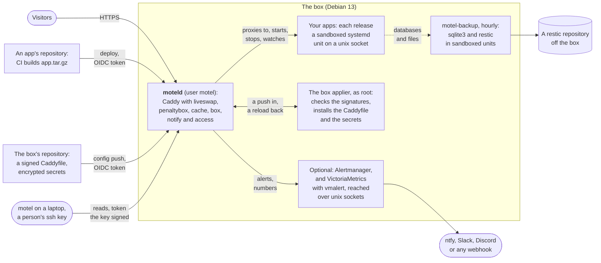

# motel

**Deploy from `git push` to a single cheap server, with zero downtime.**
One package that is your reverse proxy, your deploy pipeline, your rate
limiter, your page cache, and your apps' hourly backups, with its
config and secrets kept in git — for indie hackers, solo devs, and
small businesses running real apps on cheap servers. No Docker, no
Kubernetes, no SSH keys in CI. Powered by
[Caddy](https://caddyserver.com).

```
git push  →  CI builds app.tar.gz  →  webhook  →  motel swaps it live. Zero downtime.
```

What runs on the box, and what talks to it:



Of everything in the picture, moteld alone has a port on the box's
network. Everything from outside arrives there over HTTPS: a visitor's
request, a deploy from an app's CI, a config push from the box's
repository, a person reading from a laptop. moteld reaches the apps,
Alertmanager and the metrics store over unix sockets.
[How motel fits together](docs/architecture.md) follows a request
through moteld, and a deploy from the push to the cutover.

In the server, `moteld`:

| Module | What it does |
|---|---|
| **[liveswap](liveswap/)** | Zero-downtime deploys from a CI webhook: download, migrations, a health-gated start, an atomic cutover, a graceful stop, and releases kept for a rollback. Apps run as sandboxed systemd units that outlive a moteld restart, and a watchdog restarts one that crashes or stays unhealthy. |
| **[penaltybox](penaltybox/)** | Rate limiting driven by your app's `X-Rate-Limit-Level` hint headers: weighted sliding-window budgets, tiers, and a penalty box for clients that cross them. |
| **cache** | HTTP page caching via [Souin](https://github.com/darkweak/souin), with in-memory [Otter](https://github.com/darkweak/storages) storage. |
| **[box](examples/box/)** | Config from git: the box's Caddyfile and its apps' encrypted secrets live in a repository of their own, and the box applies each signed push to `main` and rolls back a reload that fails. CI holds no SSH key. |
| **[notify](docs/monitor.md)** | Alerts and metrics (experimental): a restart loop, a failed deploy, a stale backup, a failed certificate renewal, a filling disk or a rule of your own, sent to your channels by Debian's Alertmanager, on a unix socket and no port. |
| **[access](docs/people.md)** | Read access for people (experimental): a `person` line gives someone's ssh key a role on one app or on the whole box, with no account on it. Reads only: no person can deploy, roll back or push. |
| everything Caddy has | Automatic HTTPS, HTTP/2 + HTTP/3, the Caddyfile, the admin API — motel *is* Caddy underneath, with the modules above compiled in. |

Beside it:

| Program | Where | What it does |
|---|---|---|
| **[motel-backup](docs/backups.md)** | on the box | Hourly backups of each app's declared SQLite databases and files into a [restic](https://restic.net) repository off the box, a weekly drill that proves a restore would work, and `motel-backup restore` to put an app back. A program of its own, which links no Caddy. |
| **[motel](client/)** | on your laptop | The client (experimental): reads a box over HTTPS with a person's token — an app's status, deploys, numbers and logs, the box's backups, alerts and rules — from the command line or its screens. |

Each module's design is beside its code:
[liveswap](liveswap/DESIGN-liveswap.md),
[penaltybox](penaltybox/DESIGN-penaltybox.md),
[box](box/DESIGN-box.md), [backups](backups/README.md),
[notify](notify/DESIGN-notify.md) with its
[metrics](notify/DESIGN-metrics.md), and
[access](liveswap/access/DESIGN-access.md).

## Getting started

[Your first deploy](docs/first-deploy.md) takes a fresh Debian 13
server to an app that deploys on every push to `main`, in four steps,
with the box's config in a repository of its own that the box applies
on each signed push.
[After the first deploy](docs/after-first-deploy.md) then covers
changing the config, secrets (whose reference is
[Secrets](docs/secrets.md)) and the way back, and
[Hardening the box](docs/hardening.md) covers SSH by key only, the SSH
port shut, and, optionally, an administrator who is not root,
Debian's updates installed on their own, seven kernel network
modules no app needs refused, and a memory and CPU ceiling for all the
apps together.
The first two use the three directories below, which the e2e suite
builds and deploys on every change, so what they say works:

- **[examples/node](examples/node)** — a single executable (Node's own
  build), so nothing is installed on the box. Largest tarball;
  simplest box. The tutorial's default. Start your own from the
  template it is published as, [motel-example-node](https://github.com/smallhoursorg/motel-example-node).
- **[examples/deno](examples/deno)** — `deno run` with a Deno installed
  under `/usr` on the box, and the runtime's permission flags held in
  the box's Caddyfile, where a compromised build cannot widen them.
  Its template is [motel-example-deno](https://github.com/smallhoursorg/motel-example-deno).
- **[examples/box](examples/box)** — the box's config, kept in a
  private repo of its own: a Caddyfile per box (which app, which repo
  may deploy it, where the deploy webhook answers, who may sign a
  change), applied by the workflow on each signed push to `main`; the
  box checks the signatures and keeps the file it had if the new one
  does not load. The apps' secrets live there too, encrypted, one
  file per value ([docs/secrets.md](docs/secrets.md)). Its template is
  [motel-example-box](https://github.com/smallhoursorg/motel-example-box).

Both apps serve on the socket motel hands them, answer `/health`,
migrate before each version starts, stop cleanly, and deploy from
GitHub Actions with no stored secret.

[Backups](docs/backups.md) copies each app's databases and files into a
bucket off the box every hour, proves weekly that a restore would
work, and puts an app back.
[Monitor](docs/monitor.md) (experimental, since v0.7.0) tells you
when something on the box goes wrong, at ntfy, Slack, Discord or any
URL that takes Alertmanager's JSON, and keeps each app's numbers.
[Giving a person access](docs/people.md) (experimental, since v0.8.0)
lets someone you name read an app from their laptop, with their own
ssh key and no account on the box: its status and deploys, its
alerts and numbers, and with a `logs` grant its logs.

## Install

A `.deb` for amd64 and arm64 on the
[releases](https://github.com/smallhoursorg/motel/releases) page.
[Your first deploy](docs/first-deploy.md) installs it and deploys an
app, in four steps; [Upgrading](docs/upgrading.md) is every release
after that. The package gives you `/usr/bin/moteld`, a systemd
service, `moteld.service`, running as the `motel` user, a starter config at
`/etc/motel/Caddyfile`, a systemd instance for the `motel`
user that stays up without anyone logging in — the thing your apps
will run under — and, for a box whose config lives in a repository,
the root applier that installs each signed push and the box's key
for secrets.

**Supported: Debian 13, on a real virtual machine.** The package
refuses to install where systemd is older than 257 (Debian 12 and
earlier, Ubuntu 24.04): each app's sandbox needs it. It installs on other Debian-based
distributions with systemd 257 or newer, but nothing else is tested.
On a host that cannot deliver the per-app sandbox — many LXC-based and
other container-style servers — motel refuses a config that runs
apps rather than serving something weaker; [liveswap/README.md](liveswap/README.md#sandbox)
has what a host has to provide.

What the package depends on and suggests, and why, is under
[Dependencies](#debian-packages-on-the-box).

<details>
<summary><b>Without the package</b> — the raw binary, for other systemd hosts</summary>

The `moteld_<version>_linux_<arch>.tar.gz` archives on the same page
hold the **raw binary** (plus LICENSE and a README; and
`motel-backup` with its unit files, for [backups](backups/README.md)),
for other systemd
hosts you wire up yourself — a NixOS-style distro, say. A script that
still fetches the name they had up to v0.7.0, `motel_…`, gets the
laptop client in the server's place ([Upgrading](docs/upgrading.md)).
Prefer the
packages where you can: going this way you take on what the package
does for you, all of it in [packaging/](packaging/) (`nfpm.yaml` and
`postinstall.sh` are the whole list): a dedicated `motel` user, the
`Type=notify` unit `moteld.service`, `loginctl enable-linger
motel` (with `libpam-systemd` installed) so the user manager exists
for your apps, the config at `/etc/motel/Caddyfile`, and, for config
pushed from a box repository, the root applier's units
(`motel-box-apply.path` and `.service`), its directories
(`motel-box.tmpfiles`) and the box's key (`moteld box key`, as
root). The sandbox applies here too, so the host
needs systemd 257 or newer and has to deliver both namespaces (many
container and LXC hosts cannot) and seccomp. moteld checks both from
inside a test unit at start and refuses to start rather than run your
apps without them. One case passes that check: a container host whose
existing seccomp rules leave the kernel no room for the app units'
system-call filter
([liveswap/DESIGN-sandbox.md](liveswap/DESIGN-sandbox.md), "What this
does NOT stop").

**systemd is not optional.** liveswap runs your apps as transient
units on your user's systemd manager and there is no fallback runner,
so this is not a path onto a non-systemd host. motel would still
serve there — Caddy, the cache, penaltybox — but a Caddyfile defining
any `app` refuses to start. That is also why there is no `.apk`:
Alpine runs OpenRC, and an Alpine package would install a moteld
without the feature it exists for.

</details>

(A hosted APT repository with automatic updates is on the roadmap.)

The laptop client, `motel` (experimental; [client/](client/README.md)),
is on the same page from the release after v0.8.0, for an M-series Mac
and for Linux on amd64 and arm64, as
`motel_<version>_<os>_<arch>.tar.gz`. Its README's
["Getting it"](client/README.md#getting-it) fetches and checks the one
for the machine it runs on. Until that release, and on any other
machine (an Intel Mac, say), it builds from a clone.

**Installing and upgrading need root; everyday administering does
not.** moteld itself runs unprivileged. The config changes only by a
signed push from the box's repository ([examples/box](examples/box)),
and so do the apps' secrets kept there, as values encrypted to the
box's own key ([docs/secrets.md](docs/secrets.md)). Checking a config
(`moteld validate`) needs no privilege, except on the box for a file
whose `monitor` block has more than a `metrics` line: validate then
reads the box's secrets in `/etc/motel/secrets`, which only root and
the `motel` group can enter, so run it as root there. Reading the
journal — moteld's and every app's — needs the `adm` group, which
reads the whole system journal and so is a trust grant in its own
right ([Hardening the box](docs/hardening.md)).

## What motel is (and isn't)

- **A server product, distributed like Caddy.** Same CLI, same
  Caddyfile, same admin API — `moteld run`, `moteld reload`,
  `moteld validate` all behave exactly as Caddy's do. The config is
  a Caddyfile, though: a JSON config (a `.json` file, or JSON posted
  to the admin API) is unsupported, because Caddy deletes every
  `"@id"` key from JSON before motel's checks can see it.
- **Made for one cheap server.** Apps run as systemd units under
  motel's own user manager, reached over unix sockets; no container
  runtime anywhere. That's why there's deliberately no Docker image.
- **Not a cluster.** Single-node by design. If you outgrow one server,
  you've outgrown motel — a good problem.

## Security

The threat model is [DESIGN-threat-model.md](DESIGN-threat-model.md);
to report something, [SECURITY.md](SECURITY.md). Four properties it
rests on:

- **The admin API is not on localhost.** It listens on a unix socket
  rather than TCP: "localhost-only" would include every app you run,
  and one SSRF bug in an app could otherwise reconfigure the server.
  Apps themselves run unprivileged, with `NoNewPrivileges`, and write
  no core dump (`LimitCORE=0`), so a crash cannot leave an app's
  memory on disk.
- **Every app is sandboxed, with no opt-out.** Apps share the
  `motel` user, so each runs in its own systemd sandbox: it sees
  its own release, its `shared/` data, its instance's socket directory
  (`run/<nonce>/`), a private `/tmp`, and the parts of the OS it needs. Nothing else on the host exists in its view —
  motel's keys and every sibling app are *absent* from its
  filesystem and invisible in its process table, not merely
  unreadable. A host that cannot deliver that refuses to start rather
  than run something weaker. What is shared by design is the network,
  for outbound calls; nothing motel runs listens on a port.
  Details: [liveswap/README.md](liveswap/README.md#sandbox).
- **Deploys are authenticated without a shared secret.** A deploy, and
  a config push, carries a short-lived token — an OIDC token from CI,
  verified against the provider's public keys, or one signed by a
  local key whose public half the box holds. Nothing an attacker can
  steal off the box lets them deploy.
- **motel cannot change its own config.** The Caddyfile is the box's
  policy — which repository may deploy each app, each runtime's
  permission flags, who may sign the next change — and only root
  writes it. A push from the box's repository reaches root through
  motel, and root installs the file only if the commit descends
  from the one the box runs and is signed by a key the running file
  names. Details: [box/DESIGN-box.md](box/DESIGN-box.md).

## Dependencies

You're being asked to install this on a production server, so
here's exactly what's in the two binaries, `moteld` and
`motel-backup`, and what they drag in. Module counts are the modules
reachable from each dependency in the root module's `go mod graph`
(`GOWORK=off`, deduplicated by module path), measured 2026-11-22; the
"Adds" column shows what each dependency adds *beyond* what's
already in the tree above it, because the trees overlap almost
entirely. (Counts exclude the `govulncheck` tool dependency — a
`tool` directive is never compiled into the product and never
inherited by importers; it exists in go.mod so Dependabot can bump
the scanner.)

| Dependency | Adds | Required by | Notes |
|---|:-:|---|---|
| [Caddy](https://github.com/caddyserver/caddy) | ~600 | moteld, liveswap, penaltybox, box, notify | The foundation — motel *is* a Caddy distribution. Commercially sponsored, strong security track record. Nearly the entire dependency tree is Caddy's. |
| [Souin](https://github.com/darkweak/souin) (`cache`) | +5 | moteld | HTTP cache (RFC 7234). Solo-maintained; the e2e suite exercises it directly so drift is caught in CI. The riskiest dependency here, and still better than an in-house HTTP cache. |
| [darkweak/storages/otter](https://github.com/darkweak/storages) | +5 | moteld | In-memory storage backend for Souin, wrapping [maypok86/otter](https://github.com/maypok86/otter). |
| [age](https://github.com/FiloSottile/age) (`filippo.io/age`) | +4 | box | Secrets: each value in the box repository is an age file encrypted to the box's own key, which root decrypts on the box into the app's env file. Chosen over SOPS, whose library measured 80 more modules in a binary root runs ([box/DESIGN-box.md](box/DESIGN-box.md), "Decisions and rejected alternatives"). |
| [zap](https://github.com/uber-go/zap) | \* | liveswap, penaltybox, box, notify | Caddy's module logging API is zap; not optional for a Caddy module. |
| [go-humanize](https://github.com/dustin/go-humanize) | \* | liveswap | A few formatting helpers in liveswap. |
| [go-systemd](https://github.com/coreos/go-systemd) (`dbus`) + [godbus](https://github.com/godbus/dbus) | \* | liveswap, motel-backup | liveswap's runner: apps are transient units created over systemd's D-Bus API on the motel user's own manager (no polkit, no root). motel-backup starts its restic and sqlite3 units the same way. Both arrive in Caddy's tree anyway (smallstep's CA requires go-systemd, which requires godbus, pure Go); for motel-backup, which links no Caddy, they and `golang.org/x/sys` are all its binary links from outside this repository. |
| [go-oidc](https://github.com/coreos/go-oidc) + [go-jose](https://github.com/go-jose/go-jose) | \* | liveswap | Deploy authentication (`deploy_trust`): OIDC discovery/JWKS verification and JWT signing/verification. Both were already transitive dependencies of Caddy; liveswap now requires them directly, and box's pushes use the same verifier through liveswap. Vetted and widely used — the deliberate alternative to hand-rolling JWT crypto. |
| [x/crypto](https://pkg.go.dev/golang.org/x/crypto) (`ssh`) + [edwards25519](https://github.com/FiloSottile/edwards25519) | \* | liveswap, box | The ssh formats. box reads `signer` keys and takes a commit's ssh signature apart with it (the check itself is the system `ssh-keygen -Y verify`). liveswap's `access` checks in-process the signature a person's token is, only when the token's key is of a type some listed key has (a box that declares no one lists none), and refuses an Ed25519 key of small order (edwards25519), on a `person` line and, for box, on a `signer` line. The client's binary links neither: it reads a key with the standard library and signs with the system `ssh-keygen`. The Go team's and Filippo Valsorda's; Caddy's own go.mod requires both. |
| [cobra](https://github.com/spf13/cobra) + [pflag](https://github.com/spf13/pflag) | \* | moteld, box, notify, client | Caddy's own CLI is cobra, so anything that adds a subcommand speaks it: box registers `moteld box ...` through Caddy's command API, notify `moteld monitor ...` the same way, and `cmd/moteld` parses a command's flags with Caddy's own definition of them before its backup check runs. The client, `motel`, parses its commands with cobra too. |
| [Prometheus's client libraries](https://github.com/prometheus/client_golang) (`client_golang`, `client_model`, `common`) | \* | notify | notify's numbers: the box's and each app's are registered on Caddy's registry for the config, which is gathered and pushed whole to the metrics store in Prometheus's text format, and Alertmanager's delivery counters are read in the same format. Caddy's own metrics are built on them. |
| [yaml](https://github.com/yaml/go-yaml) (`go.yaml.in/yaml/v3`) | \* | notify | The two files notify writes for Debian's programs: Alertmanager's config and vmalert's rules. |
| [tview](https://github.com/rivo/tview) + [tcell](https://github.com/gdamore/tcell) | +3 | client | the screens `motel` alone opens only, in the laptop client; no server links them. Counted in the client's binary, the one place they are: tview, tcell and gdamore/encoding (go-colorful, uniseg and the `x/` modules they bring are in the tree above). tview has one maintainer and no release since 2025-08, and it stays on tcell v2: the TUI keeps its screens thin over a model with no terminal library (`internal/tui/model`), so a move to another library costs the screens alone. tview reads `[...]` tags in box text, which `internal/tui/door` makes inert (client/README.md, "The TUI"). |

\* Adds nothing: already in Caddy's tree.

"Required by" names whose own code requires the dependency: a module
compiled into moteld (liveswap, penaltybox, box, notify; "moteld" is
the product's own `cmd/moteld`), or one of the other two binaries,
motel-backup and the client. The product binary, moteld, contains
every row but the last, the client's screens. A module not named is
not "absent from that module's graph": the rows marked \* arrive via
Caddy either way. For motel-backup, the other binary on the box, not
named does mean absent from the binary: it links no Caddy, so its
binary holds the one row that names it plus `golang.org/x/sys` (its module
graph is larger, as the client's below is, and for the same reason: its
go.mod requires liveswap's). What it needs
beyond its own binary are programs, not modules: Debian's `restic`
and `sqlite3`, which the package depends on, run in units of their
own ([backups/README.md](backups/README.md)).

The client is the laptop client, `motel`, which no server
installs: it too links no Caddy, and its binary holds the client's own
packages, `liveswap/wire`, cobra and pflag, and for its screens tview,
tcell and the modules they bring (gdamore/encoding, go-colorful,
uniseg, x/term, the x/sys it brings, and x/text; x/term is also what
the client itself asks whether stdout is a terminal), and nothing else
(`TestLinksNoCaddy`). Its
module graph is larger than that (about 190 modules) only because
`liveswap/wire` is a package of the liveswap module, whose go.mod
requires Caddy.

Build and CI tooling is pinned in `docker-compose.yml`. Two of its
images shape what ships, and are pinned by digest (the tag beside it
is for Dependabot and for people): `golang` (the toolchain that
compiles moteld, motel-backup and the client) and `nfpm` (writes the
`.deb`). The rest never ship to users and are
pinned by image tag: `golangci-lint`, `gitleaks` (secret scan),
`python` (the usage ledger and pin-watch) and `curl` (the e2e runner).
GitHub Actions are pinned to commit SHAs.

What keeps this honest: `govulncheck` gates every PR that changes code and runs weekly
against the fresh vulnerability database (reachable-code analysis, all
modules; the only exceptions are the reviewed `govulncheck:` entries
in `pin-watch.yml`, each with its evidence), every release is blocked until the full test matrix passes —
including installing the actual `.deb` under systemd on Debian 13, on
both architectures — and any dependency bump has to survive all of the
above before it merges.

### Debian packages on the box

The package depends on `libpam-systemd`, `dbus` and
`openssh-client`, all present on a stock Debian server: liveswap runs
your apps as systemd units under the `motel` user's own service
manager, which needs `pam_systemd` to start and `loginctl` to stay
alive without a login, and the box checks each config commit's SSH
signature with `ssh-keygen`. And on `restic` (23 MB), `sqlite3` and
`ca-certificates`, for [backups](backups/README.md): a box that uses
none carries the two programs too, so that one whose image installs no
recommended package (Hetzner's Debian 13) gets them; the CA store is
what moteld and restic verify every certificate against.

It suggests `prometheus-alertmanager` (Debian's, 46 MB installed),
for [notify](notify/DESIGN-notify.md): not a dependency, because
Debian's unit starts listening on a port the moment it is installed.
`moteld monitor setup`, as root, masks it, installs it and starts it on
a unix socket only.

It suggests `victoria-metrics` (Debian's, 143 MB installed, vmalert
included) for the metrics store ([notify/DESIGN-metrics.md](notify/DESIGN-metrics.md),
experimental), for the same reason: its unit listens on `0.0.0.0:8428`,
unauthenticated, once installed. `moteld monitor setup --metrics`, as
root, sets up Alertmanager as above if it is not yet, then masks it,
installs it and starts it in a network namespace of its own, reached
through a unix socket only.

### Dependency policy

Dependabot opens grouped PRs per ecosystem with a 7-day cooldown
(security updates bypass it), checking Go modules daily and the rest
weekly; patch/minor bumps auto-merge
once the full CI graph is green. Two escape hatches, both declared in
[`.github/pin-watch.yml`](.github/pin-watch.yml) and enforced by the
weekly `pin-watch` workflow:

- **Pins.** Every pin must have a `watches` entry declaring the
  machine-checkable condition under which it is lifted (e.g. "caddy's
  latest release requires cel-go ≥ 0.29"): an `ignore` in
  `dependabot.yml`, or a require go.mod holds itself ahead of the last
  tag, which the entry then names as its `min_version`. The workflow
  opens an issue when a condition is met, and flags any ignore↔watch
  drift and any go.mod↔watch drift — a pin can never rot silently.
- **Alert triage.** `alert_dismissals` entries auto-dismiss Dependabot
  alerts by GHSA id, and `code_scanning_dismissals` entries do the same
  for CodeQL alerts by rule + file (with an `expect` cap so a new flow
  in the same file is never silently swallowed) — each with a reviewed
  reason and evidence comment (280 characters, what GitHub keeps; a
  longer one is refused, not posted cut), so triage decisions are
  versioned instead of buried in the UI. Unlisted alerts stay open and
  notify as normal. An entry whose alerts have all been fixed is
  flagged as stale, and an alert open again in a go.mod and package
  that had been fixed is a reintroduction, named rather than
  dismissed. An `alert_dismissals` entry may also
  name the advisory's Go vulndb ID (`govulncheck:`); `make vulncheck`
  then lets that one ID through, and fails once nothing calls it any
  more. This needs the
  `DEPENDABOT_ALERTS_TOKEN` Actions secret — a fine-grained PAT with
  **Dependabot alerts: read-write** on this repository only — because
  the Actions `GITHUB_TOKEN` cannot access the alerts API.

## Status

This README describes `main`, which is ahead of the latest release,
v0.8.0. What it names that v0.8.0 lacks arrives with the release after
it: the laptop client's archives on the releases page, the `logs`
grant, and what a person reads beyond an app's status and deploys (the
box's backups, alerts and rules, an app's numbers and logs).

Experimental, which means what each reads or sends may change until a
release's notes say otherwise: [monitor](docs/monitor.md), alerts and
metrics, since v0.7.0; [people's read access](docs/people.md) and the
laptop client, [motel](client/README.md), since v0.8.0.

## Roadmap

- **Per-app UIDs.** Apps share the unprivileged `motel` user; giving
  each its own would need a small privileged helper, so it stays a
  later milestone.
- **A hosted APT repository**, with package signing and auto-updates.

## Questions, bugs and ideas

They go in [Discussions](https://github.com/smallhoursorg/motel/discussions);
issues and pull requests are the maintainer's. See
[CONTRIBUTING.md](CONTRIBUTING.md).

## Development

No local Go toolchain needed — everything runs in Docker, through the
Makefile. `make help` lists every target, a line each; the ones a
change usually needs:

```sh
make test              # unit tests, all modules; PKGS=./notify/... one module, RUN=TestName one test
make lint              # golangci-lint, both tag sets; MODULES="notify box" those modules alone
make test-integration  # real deploys through caddytest, under a real systemd user manager
make e2e               # the shipped binary under systemd: deploys, rate limits, restarts, box pushes, people
make package           # the .deb and the client's archives, into dist/
```

The other e2e lanes (`e2e-backup`, `e2e-notify`, `e2e-metrics`), and
which part of a lane covers which change, are in [AGENTS.md](AGENTS.md).

`test-integration`, `install-test` and the e2e lanes boot systemd inside a
privileged container, which needs a cgroup-v2 Docker host — Docker
Desktop (macOS/Windows) or Linux with systemd both qualify; the targets
check and say so up front (`soak` boots the e2e lane's box too, and
does not check first). That is also how liveswap's systemd runner
is developed and tested on a Mac: nothing here needs a Linux VM.

What building motel costs — Claude Code sessions, runner minutes,
Copilot reviews, in money, kWh and CO2 — is a committed ledger:
[docs/footprint.md](docs/footprint.md).

The repo is a Go multi-module workspace:

- **`liveswap/`, `penaltybox/`**: lean, independently usable Caddy
  modules (`xcaddy build --with github.com/smallhoursorg/motel/liveswap`).
- **`box/`**: a module of its own but part of the product only. It
  imports liveswap through a local `replace`, so it builds only from
  this repo, and it runs only with the package's applier units
  ([box/DESIGN-box.md](box/DESIGN-box.md)).
- **`backups/`**: builds `motel-backup`, the program that starts
  restic and sqlite3 in root-equivalent units, so it links no Caddy.
  Of the server it takes the declaration package
  (`liveswap/backupdecl`) and the wire types, and the server links its
  look at the backups, the one `motel-backup status` takes
  (`backups/look`, and with it the packages that imports, the engine's
  among them).
- **`notify/`**: part of the product only. It imports liveswap and the
  backups' record and verdict (`backups/record`, `backups/status`)
  through local `replace`s, and nothing imports it but the root module
  (liveswap reports to an interface).
- **`client/`**: the laptop client `motel`, experimental, and a module
  of its own so that it links no Caddy. Of this repository it takes
  only the wire types (`liveswap/wire`, standard library only),
  through a local `replace`; the tests that run it against the real
  webhooks are in the liveswap and box modules.
- **The root module** builds the product binary from `cmd/moteld`.
- **`packaging/`** turns `moteld` and `motel-backup` into the `.deb`:
  what ships and at which mode (`packaging/nfpm.yaml`'s comments), the
  maintainer scripts and the units. The triage of the scripts is
  [packaging/DESIGN-packaging.md](packaging/DESIGN-packaging.md).

## License

Apache-2.0. motel is powered by [Caddy](https://caddyserver.com),
[Souin](https://github.com/darkweak/souin),
[Otter](https://github.com/darkweak/storages), and
[age](https://github.com/FiloSottile/age).
