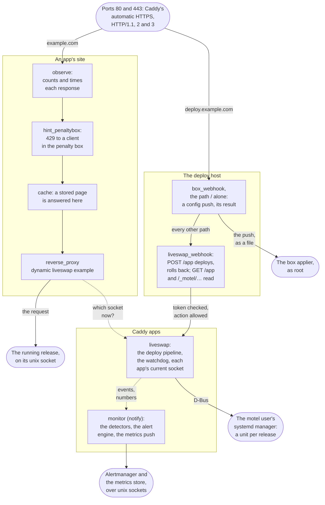
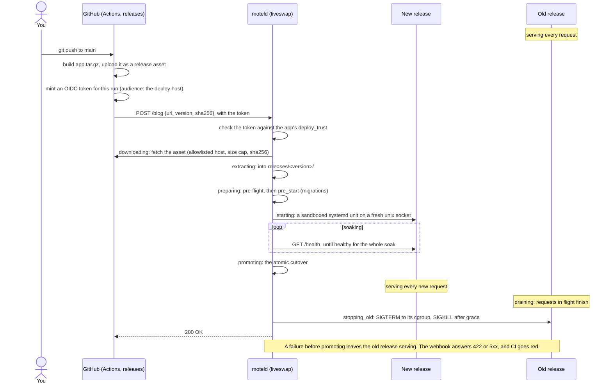

# How motel fits together

Two pictures: what a request passes through inside moteld, and what a
deploy does from the push to the cutover. The picture of the whole
box, with what talks to it, is at the top of the
[README](../README.md). Each section ends with where its details are
written down.

Names are the ones [Your first deploy](first-deploy.md) uses: the app
`example` at `example.com`, and the box's deploy host,
`deploy.example.com`.

## Inside moteld

moteld is Caddy with motel's modules compiled in: one process, running
as the `motel` user, configured by one Caddyfile. Its modules are of
two kinds. Handlers stand in a site's route and see each request.
Caddy apps run beside the HTTP server and hold what the handlers ask
for.

**An app's site.** Only `reverse_proxy` is required. `observe`,
`hint_penaltybox` and `cache` are each a line the operator adds, and
the order shown is the one a `route` block keeps: the observer first,
so that it counts what the other two answer, and the penalty box
before the cache, so that a boxed client gets no cached page. Outside
a `route` Caddy runs `cache` first
([penaltybox/README.md](../penaltybox/README.md), "Compatibility with
Souin"). The proxy holds no address for the app: for each request it
asks liveswap which socket the app's running release listens on. That
answer is the one thing a deploy changes, so a cutover needs no config
reload.

**The deploy host.** One site answers everything that is not a
visitor. `box_webhook` takes the path `/`, a config push from the
box's repository and the poll for its result, and passes every other
path on. `liveswap_webhook` takes the rest: a deploy or a rollback
from an app's CI, the status reads, and under `/_motel/` what a person
reads with the laptop client. Each request carries a token: an OIDC
token from CI, one a local key signed, or one a person's ssh key
signed. The handler checks the token first, and then whether its
holder may take that action on that app ([liveswap/access/DESIGN-access.md](../liveswap/access/DESIGN-access.md)).

**The Caddy apps.** `liveswap` owns the apps: it runs the deploy
pipeline, starts and stops each release as a transient unit on the
`motel` user's systemd manager, over D-Bus, and its watchdog restarts
a release that crashes or stays unhealthy. The units are systemd's,
not moteld's children, so they keep serving through a config reload
and a moteld restart. `monitor`, the notify module, takes liveswap's
events and each app's numbers, sends alerts to Alertmanager and pushes
the numbers to the metrics store, where the box has them set up.
`box`, not drawn, holds who may push the config and who may sign it.

**What moteld cannot do.** It runs unprivileged and cannot write its
own Caddyfile. A config push leaves `box_webhook` as a file in
`/var/lib/motel-box/in`, and the box applier, a root unit that a path
unit starts, checks the commit's signatures again, installs the file
and the secrets, and reloads moteld. The admin API is a unix socket,
`/run/motel/admin.sock`, with no TCP port, which no app can reach.

Details: [liveswap/DESIGN-liveswap.md](../liveswap/DESIGN-liveswap.md),
"Architecture"; [box/DESIGN-box.md](../box/DESIGN-box.md), "The trust
chain" and "Sequences", which draws a config push step by step;
[notify/DESIGN-notify.md](../notify/DESIGN-notify.md) and
[notify/DESIGN-metrics.md](../notify/DESIGN-metrics.md), "The shape".

## A deploy

A push to an app's `main`, as the example workflows do it on GitHub
Actions. `blog` is the app.

The words before each colon are the deploy's phases, as the webhook's
answer and `motel status` name them. Three things the picture leaves
out:

- **Nothing secret is stored anywhere.** The token is minted for the
  one run and names the repository, branch and workflow it came from.
  The box holds only the `deploy_trust` block that says which of those
  may deploy the app.
- **The request stays open for the whole deploy**, so the workflow's
  step succeeds or fails with it.
- **After the cutover nothing reverts by itself.** The watchdog
  restarts the same release, and the releases before it stay on disk:
  `POST /blog?rollback=<version>` puts one back through the same
  phases, without the download and the migrations.

Details: [liveswap/README.md](../liveswap/README.md), "How a deploy
works", "Webhook API" and "Deploying from CI".
